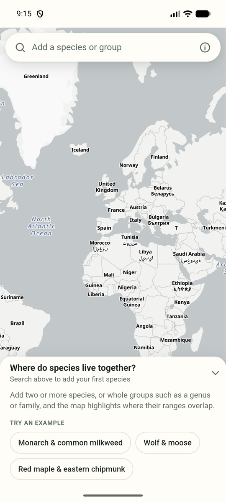
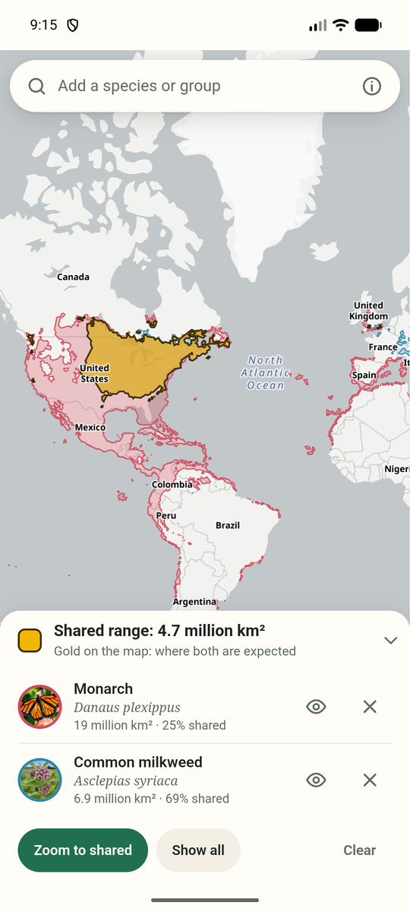

# SpeciesMap

An Android app that shows where the ranges of two or more species overlap. Search for species
by common or scientific name, and the map highlights the area where all of them are expected.

 

**[Download the latest APK](https://github.com/Unpiloted0852/SpeciesMap/releases/latest)**

Coffee: https://ko-fi.com/unpiloted0852

## What it does

- Search [iNaturalist](https://www.inaturalist.org) by common or scientific name and pick from
  suggestions with photos.
- Each species' range is drawn in its own colour; the area they all share is drawn in gold, with
  its size and the share of each species' range it covers.
- Add a genus, family or other group and the app combines the ranges of its 40 most-observed
  species. A group can also be broken out to show each of its species in its own colour; tap
  one to spotlight it.
- **Sightings** overlays research-grade iNaturalist observations as dots in each species'
  colour, for detail finer than the range model's roughly 45 km cells.
- Hide a species with the eye button to compare the rest, tap a row to zoom to that range, or
  tap the map to see which of your species are expected at that spot.
- Compare up to eight at once. The list is remembered between launches.
- Light and dark themes follow the system setting or can be chosen in the About sheet. Dark
  is true black for OLED screens.

## Things worth knowing

- The ranges are predictions from iNaturalist's
  [geomodel](https://www.inaturalist.org/geo_model), built from where people have recorded each
  species. They are estimates, not surveyed boundaries, and less-observed species may have no
  range at all.
- iNaturalist's published range files are wrong for some very widespread species (red fox,
  house sparrow, rock pigeon), where most of the range is missing. The app checks each file
  against iNaturalist's own map tiles of the same model and, when the file falls far short,
  rebuilds the range by tracing those tiles.
- The app needs an internet connection for search, ranges and the map.
- No API keys are needed. The base map is [OpenFreeMap](https://openfreemap.org) (OpenMapTiles
  schema, OpenStreetMap data), drawn with [MapLibre GL JS](https://maplibre.org); range geometry
  is worked out on the device with [Turf](https://turfjs.org). Both libraries are bundled in
  `app/src/main/assets/lib`.
- The whole interface is one page, `app/src/main/assets/index.html`, hosted in a WebView. Serving
  that folder with any static web server runs it in a desktop browser.

## Building

Open the folder in Android Studio, or run:

```bash
./gradlew assembleDebug
```

Release signing is read from an untracked `keystore.properties` in the project root
(`storeFile`, `storePassword`, `keyAlias`, `keyPassword`); without it the release build is
left unsigned.

## Updates

The app checks this repository's GitHub Releases at launch. If a newer version is published,
an "Update to version …" button appears under the search bar; one tap downloads the APK and
hands it to Android's installer. The update closes the app, and Android does not let an app
reopen itself, so it is opened again by hand. To ship an update: bump `versionCode` and
`versionName`, build a release APK signed with the same key, and publish a GitHub release
tagged `v<versionName>` with the APK attached.

Range data © iNaturalist, CC BY 4.0. Not affiliated with iNaturalist.
